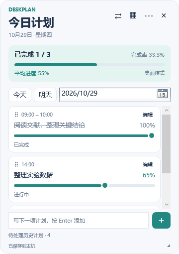
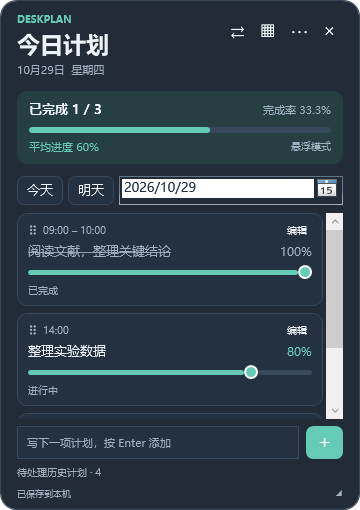
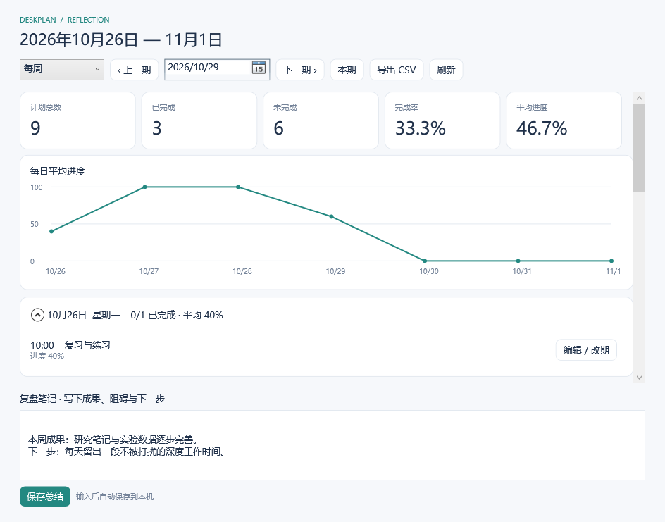

# DeskPlan · 桌面计划

**把每天的计划放在桌面上，用进度记录行动，用回顾留下积累。**

面向 Windows 的离线每日计划工具，支持桌面壁纸层与悬浮置顶、进度滑块、重复计划和日 / 周 / 月回顾。无需账号，计划与历史保存在本机。

[下载正式版](https://github.com/yanlREN/DeskPlan/releases/latest) · [快速入门](docs/quick-start.md) · [图文操作手册](docs/user-guide.md) · [更新记录](CHANGELOG.md) · [反馈问题](https://github.com/yanlREN/DeskPlan/issues)

## 界面预览

<p>
  
  
</p>

截图来自隔离测试环境。首次使用从空白计划开始。

## 下载与运行

1. 进入 [Releases](https://github.com/yanlREN/DeskPlan/releases/latest)，下载 **DeskPlan-0.1.2-win-x64.zip**。
2. **完整解压**到固定目录，双击 **DeskPlan.exe**。
3. 双击包内 **使用说明.html**，即可离线阅读图文手册。

支持目标为 **Windows 10 / 11 x64**；当前实际验证环境为 Windows 11 build 26200。自包含绿色包无需额外安装 .NET，无需管理员权限。首次启动可能稍慢。本版没有安装器、自动更新或代码签名；GitHub 的 `Source code` 是源码，不是可运行安装包。

## 主要功能

| 功能 | 说明 |
| --- | --- |
| 每日计划 | 快速添加、时间、备注、编辑、删除本次与历史记录 |
| 进度与完成 | 0–100% 滑块；完成后变灰、划线，调低进度可重新打开 |
| 重复计划 | 每天、工作日、每周；支持仅本次或本次及以后修改 |
| 桌面与悬浮 | 壁纸层、悬浮置顶、托盘唤出，保留位置与尺寸 |
| 回顾与复盘 | 日 / 周 / 月统计、趋势、月历、总结与历史未完成清单 |
| 本地提醒 | 到点、提前提醒、稍后 10 分钟；依赖程序运行及系统通知设置 |
| 数据管理 | SQLite 本机保存、JSON 完整备份恢复、CSV 导出 |
| 外观 | 浅色、深色、半透明配色、透明度、字号、手动排序 |

## 三分钟上手

1. 在底部输入标题并按 **Enter**。需要时间、重复和提醒时，点击 **＋**。
2. 拖动任务滑块记录进度，到 **100%** 自动标记完成，进度自动保存。
3. 点击 **⇄** 切换显示模式。切回桌面模式会保持显示，点 **放回桌面** 才贴回壁纸层。
4. 点击 **▦** 回顾日 / 周 / 月记录，点击 **⋯** 调整设置或导出备份。

点 **×** 默认仅隐藏到托盘；完全退出请右键托盘图标 → **退出 DeskPlan**。再次双击 EXE 或托盘图标会唤出原窗口。



## 数据与升级

数据默认保存在 `%LOCALAPPDATA%\DeskPlan`，与 EXE 目录分开。程序没有登录、云同步、遥测或后台服务器。

- 在设置中使用 **导出 JSON 备份**，并将备份保存到其他磁盘。
- 恢复备份会替换当前数据；程序会先创建原数据库的安全副本。
- 升级前备份，从托盘完全退出，再解压替换新版。不要覆盖正在运行的 EXE。
- CSV 用于阅读和分析，不能替代 JSON 全量备份。
- 程序运行时，不要单独删除或复制 `deskplan.db-wal` / `deskplan.db-shm`。

下载页附带 SHA-256 校验文件，可用 PowerShell `Get-FileHash .\DeskPlan-0.1.2-win-x64.zip -Algorithm SHA256` 对照。

## 使用边界与帮助

桌面嵌入依赖 Explorer 的壁纸窗口结构，不兼容时会回退到普通窗口；悬浮模式可继续使用。通知受 Windows 勿扰模式和通知设置影响，程序退出后不会继续提醒。

当前已通过 33 项业务测试和 30 项本机窗口检查，包含连续触发 30 次标题按钮事件。Windows 10、真实重启 Explorer、多屏跨 DPI、触控和实际通知展示等仍有人工验收项目。自动按钮事件测试不等同于物理鼠标连续点击验收。

- [完整操作手册与常见问题](docs/user-guide.md)
- [已知问题与兼容性](docs/known-issues.md)
- [Windows 验收记录](docs/windows-manual-test.md)

## 从源码构建

需要 Windows、[.NET 10 SDK](https://dotnet.microsoft.com/download/dotnet/10.0) 和 PowerShell 7（用于生成离线手册）。

```powershell
git clone https://github.com/yanlREN/DeskPlan.git
cd DeskPlan
pwsh -File ./scripts/Build.ps1
```

输出在 `artifacts/`；自包含 EXE 在 `artifacts/publish/win-x64/DeskPlan.exe`。脚本会还原依赖、构建、运行业务测试、打包程序及离线手册，生成 ZIP 和校验文件。GitHub Actions 使用同一脚本构建。

运行源码或执行隔离窗口集成测试：

```powershell
pwsh -File ./scripts/Run.ps1
pwsh -File ./scripts/Build.ps1 -SmokeTest -NoPackage
```

集成测试使用独立数据库并临时打开窗口，不修改日常数据。仅需编译时也可运行 `dotnet build DeskPlan.sln -c Release`。详见 [架构说明](docs/architecture.md) 与 [贡献指南](CONTRIBUTING.md)。

```text
src/DeskPlan.App/             WPF 界面、ViewModel、应用协调与窗口集成检查
src/DeskPlan.Core/            模型、进度、重复规则、统计、提醒判定
src/DeskPlan.Infrastructure/  SQLite、事务、历史记录、CSV 与 JSON
src/DeskPlan.Windows/         Win32 宿主、屏幕边界、托盘、自启动
tests/DeskPlan.Tests/         业务与持久化测试
scripts/                     运行、构建、打包与离线手册生成
docs/                        图文手册、架构、验收与已知问题
```

## 许可证

DeskPlan 源码采用 [MIT License](LICENSE)。随程序分发的第三方组件保留各自许可，见 [第三方声明](THIRD-PARTY-NOTICES.md)。

