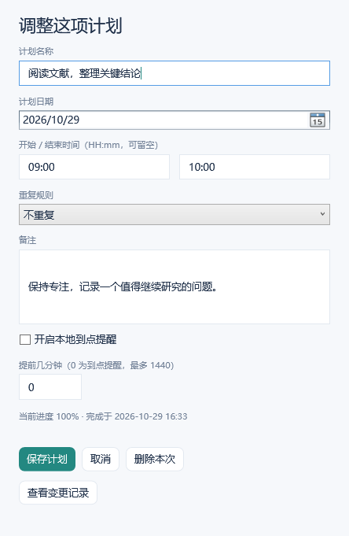
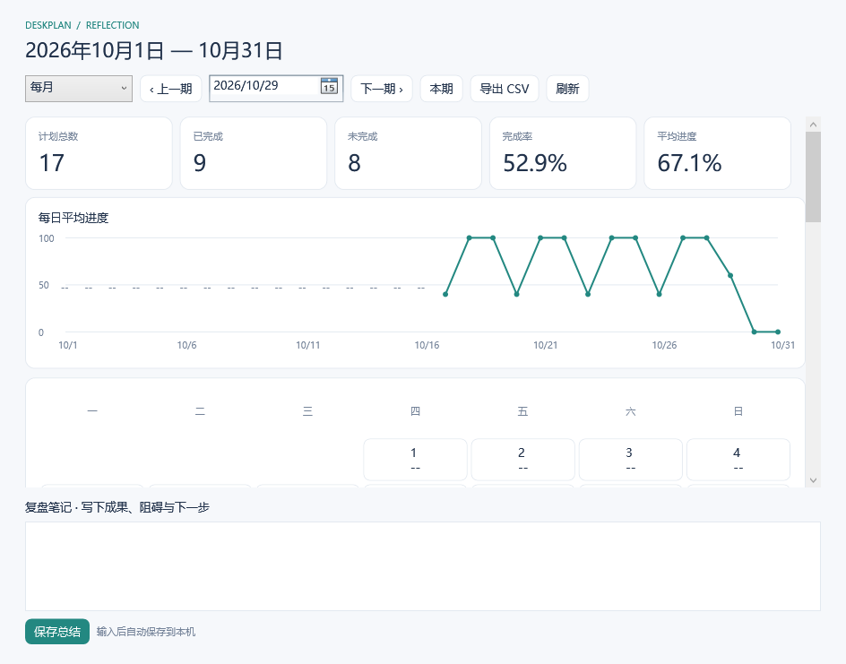
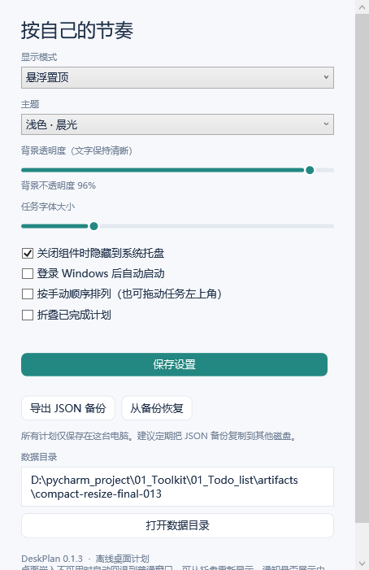

# DeskPlan 操作手册

**版本：v0.1.3 · 平台：Windows 10 / 11 x64 · 更新日期：2026-10-30**

DeskPlan 是一个离线桌面每日计划工具。计划、进度和历史都保存在本机，不需要登录账号。截图使用隔离数据库中的演示数据，首次运行不会自动添加这些任务。

## 一、安装与首次启动

1. 打开 [正式版本下载页](https://github.com/yanlREN/DeskPlan/releases/latest)。
2. 下载 Assets 中的 `DeskPlan-0.1.3-win-x64.zip`，完整解压后双击 `DeskPlan.exe`。不要下载 `Source code` 来运行程序，也不要在 ZIP 预览窗口里直接运行。
3. 建议保存到固定目录，例如 `D:\Apps\DeskPlan`。程序自带运行时，无需另装 .NET 或以管理员身份运行。
4. 首次启动可能需要稍候。手动打开时会显示计划窗口；再次双击会唤出原实例。

本版提供 x64 绿色包，没有安装器和自动更新。尚未进行代码签名；若 Windows 提示文件来源或发布者未知，请核对下载地址及发布包校验值，不要关闭系统安全防护。

解压后的 `使用说明.html` 是离线手册。也可以在 GitHub 阅读本 Markdown 版本。

## 二、认识主界面

| 位置 / 按钮 | 用途 |
| --- | --- |
| **⇄** | 在悬浮置顶与桌面模式之间切换，切换时保持窗口可见 |
| **▦** | 打开历史回顾 |
| **⋯** | 打开设置与备份 |
| **×** | 默认隐藏到系统托盘；可在设置中改为退出 |
| 顶部统计卡 | 当前日期的完成数、完成率、平均进度和显示模式 |
| 今天 / 明天 / 日期框 | 切换计划日期 |
| 任务滑块 | 记录 0–100% 进度 |
| 底部输入框与 **＋** | 快速添加 / 完整编辑计划 |
| 待处理历史计划 | 查看以前尚未完成的计划 |
| 放回桌面 | 将已唤出的桌面模式窗口重新嵌入壁纸层 |
| 四条边与四个角 | 八个方向拖动调整窗口大小，指针会显示相应方向 |

拖动标题区域可以移动窗口；把鼠标移到四条边或四个角，出现双向箭头后拖动即可调整大小。拖动左边或上边时，对面的边保持固定。最小尺寸为 320 × 420 DIP，松手后保存位置与尺寸，重新打开时恢复。

任务卡片使用紧凑三行布局；长标题在卡片内省略显示，把鼠标停留在标题上可查看完整标题和备注，点击“编辑”也可查看全文。

## 三、添加与编辑计划

### 快速添加

先选好日期，在底部输入计划标题，然后按 **Enter**。快速添加的计划不指定时间，也不默认开启提醒。

### 设置时间、重复规则与备注

点击 **＋**，填写以下内容，再点“保存计划”。已有计划可点击其右上角“编辑”。

| 字段 | 说明 |
| --- | --- |
| 计划名称 | 必填；最多 200 字符 |
| 计划日期 | 这项计划安排在哪一天 |
| 开始 / 结束时间 | 使用 `09:30` 等 HH:mm 格式；可以留空，结束时间不能早于开始时间 |
| 重复规则 | 不重复、每天、工作日或每周 |
| 备注 | 补充目标、步骤或材料 |
| 开启本地到点提醒 | 需要同时指定开始时间 |
| 提前几分钟 | 0 表示到点提醒；允许 0–1440 分钟 |

编辑器中的“查看变更记录”可查看本次计划的历史修改与进度事件。“删除本次”只删除当前实例，需要确认，其他日期的重复计划仍保留。

### 重复计划的修改范围

- **每天**：每日生成独立计划，各天进度互不影响。
- **工作日**：周一至周五；周末创建时，从下一个工作日开始。
- **每周**：按照所选日期对应的星期重复。
- **仅本次**：只修改当前日期的这个实例，例如改期或改时间。
- **本次及以后**：更新当前及未来的系列，保留以前历史及已单独编辑的未来实例。该范围不适用于历史计划或已单独改期的实例。
- 若要结束后续重复，在一个可编辑的未来实例中选择“本次及以后”，把重复规则改为“不重复”；当前选中的这一次仍保留。

历史未完成的计划不会自动移到今天。请通过“待处理历史计划”自行决定改期、完成或删除。

## 四、记录进度与完成情况

拖动滑块，或点击滑块轨道改变进度。进度到 **100%** 时，任务标题变灰并加删除线，记录完成时间；调回 100% 以下会重新打开任务并清除当前完成时间，历史进度记录仍保留。

进度停止变化后会自动保存；切换日期、切换模式、退出等操作前也会提交待保存的数据。确认底部显示保存状态后，再关闭电脑。

| 键盘操作（滑块已聚焦） | 效果 |
| --- | --- |
| 左 / 右方向键 | 调整 1% |
| Page Up / Page Down | 调整 10% |
| Home / End | 到 0% / 100% |

任务默认按时间排列。拖动任务左上角 **⠿** 可以切换到手动排序；在设置中取消“按手动顺序排列”可恢复按时间排序。“折叠已完成计划”会隐藏已完成条目，不会删除其数据。

## 五、桌面、悬浮与系统托盘

### 悬浮模式

悬浮模式置顶显示在普通应用窗口上方，适合边工作边记录。不会在任务栏额外显示组件入口；通过托盘或 EXE 可以重新唤出。

### 桌面模式与“已唤出”

桌面模式保存在偏好设置中。双击 EXE、双击托盘图标，或用 **⇄** 切回桌面模式时，先以“桌面模式 · 已唤出”保持窗口可见，方便继续操作。此时会有临时任务栏入口。

点击右下角 **放回桌面**，才把窗口贴回壁纸层。普通应用窗口可以覆盖它。桌面嵌入依赖 Windows Explorer；不兼容时会显示“普通窗口 · 安全回退”，可以继续使用或改成悬浮模式。

如果窗口不见了，先再次双击 EXE，或双击系统托盘中的 DeskPlan 图标。托盘图标可能在右下角向上箭头展开的隐藏图标区。

### 隐藏、退出与开机启动

- 默认点 **×** 仅隐藏到托盘，程序和提醒仍运行。
- 完全退出：右键托盘图标 → **退出 DeskPlan**。
- 自动启动：**⋯** → 勾选“登录 Windows 后自动启动” → **保存设置**。自动启动按保存的模式运行。
- 移动程序位置后，重新保存开机启动设置，确保启动路径正确。

## 六、提醒

编辑计划时指定开始时间，勾选“开启本地到点提醒”，设置提前分钟数并保存。程序运行时定期检查提醒，并通过 Windows 托盘通知发送。

- 点最近一次通知可以打开对应计划。
- 可在任务编辑器或托盘“最近提醒：稍后 10 分钟”安排延后提醒。
- 已完成或已删除的计划不会继续触发普通提醒。
- 程序退出后不再提醒。重新打开或从休眠恢复时，只补发两小时内仍有效且未发送的提醒。
- Windows 勿扰模式、通知设置或系统策略可能阻止通知显示。

本版不支持退出程序后由通知中心的任意旧通知精确打开对应任务。

## 七、日 / 周 / 月回顾

点击 **▦**。选择“每日”“每周”或“每月”，使用日期框、上一期 / 下一期 / 本期浏览记录。

| 统计项 | 计算方式 |
| --- | --- |
| 计划总数 | 选定期间内的计划数 |
| 已完成 / 未完成 | 进度等于 100% / 小于 100% 的计划数 |
| 完成率 | 已完成数 ÷ 计划总数 |
| 平均进度 | 所有计划进度的算术平均 |

例如两项计划分别为 100% 和 40%，完成率是 50%，平均进度是 70%。没有计划的日期显示 `--`，不会当成完成或 0% 的任务日。

周从周一开始，月按自然月统计，按**计划日期**归类；未来已安排的计划也会计入对应周期。月历中的日期可以点击进入当天明细。

在底部“复盘笔记”记录成果、阻碍与下一步。停止输入约 1 秒后自动保存，也可点击“保存总结”。切换期间和关闭窗口前会保存当前总结。

点击“导出 CSV”可导出当前范围的明细和统计。CSV 用于阅读和分析，**不能代替完整 JSON 备份**。

## 八、外观设置

点击 **⋯**，选择浅色、深色或半透明主题，调整背景不透明度与任务字号，最后点击“保存设置”。还可以设置关闭到托盘、开机启动、手动排序和折叠已完成计划。

“半透明 · 玻璃”是半透明配色，不保证 Windows 系统级背景模糊效果。

## 九、数据、备份与迁移

默认数据目录为 `%LOCALAPPDATA%\DeskPlan`。在设置中点击“打开数据目录”即可访问。

| 文件 | 用途 |
| --- | --- |
| `deskplan.db` | 计划、历史、进度、总结与设置 |
| `deskplan.db-wal` / `deskplan.db-shm` | 数据库运行期间的事务文件 |
| `backups/` | 恢复或迁移前保存的数据库副本 |
| `deskplan.log` / `startup-error.log` | 本机故障诊断日志，故障发生时生成 |

### 导出完整备份

**⋯** → **导出 JSON 备份** → 选择保存位置。建议定期将备份复制到其他磁盘。软件不提供云同步；把文件分享给他人会同时分享其中的计划与备注。

### 在本机或新电脑恢复

1. 在目标电脑打开 DeskPlan，进入 **⋯** → **从备份恢复**。
2. 选择 JSON，查看备份时间、计划数与总结数。
3. 确认后恢复会**替换当前数据**。程序会先保存当前数据库的安全副本，完成后提示其路径。
4. 恢复不会自动启用或禁用该电脑的开机启动项，请按需要重新设置。

格式不正确或超出 100 MB 限制的备份会被拒绝，不会覆盖现有数据。不要在程序运行时单独复制或删除数据库事务文件；优先使用 JSON 导出。

## 十、升级与卸载

升级前导出 JSON 备份，从托盘选择“退出 DeskPlan”，完整解压新版到原程序目录后再打开。用户数据独立保存在用户目录，替换 EXE 不会清空历史。

本版没有自动更新，请从 GitHub Releases 获取新版。若更换程序目录，请重新保存开机启动设置。

卸载时先在设置中关闭开机启动并保存，再退出程序，移除程序文件夹即可。默认保留用户数据目录。若确实要清除历史，先备份并确认不再需要，再自行处理该数据目录。

## 十一、常见问题与反馈

### 双击后没有看到窗口

稍候后再次双击，或双击托盘图标。手动打开应将窗口唤到前台。检查是否运行了旧版；版本号可在设置页查看。

### 点击 ⇄ 后窗口消失

v0.1.2 已调整为切换时保持窗口显示。确认已经退出旧进程并运行新版，而不是只覆盖压缩包。要主动进入壁纸层，请点“放回桌面”。

### 显示“安全回退”

表示当前 Explorer 环境不支持本次桌面嵌入。数据仍在，可以继续使用普通窗口，或切换到悬浮模式。不同 Windows 更新、桌面管理工具和远程会话可能影响该行为。

### 没有收到提醒

检查开始时间、提醒开关、提前分钟数、计划是否已完成、程序是否仍在托盘，以及 Windows 通知和勿扰设置。电脑关机或程序退出期间不会即时提醒。

### 日期里没有计划，或找不到已完成的任务

先检查所选日期，以及设置中的“折叠已完成计划”。历史未完成任务可从底部入口查找；周期统计依据计划日期，不是完成时间。

### 启动报错或保存失败

保留原数据与日志，先确认数据目录所在磁盘有足够空间。不要删除数据库来“重置”。程序不会在数据库不兼容或损坏时自动覆盖为空数据库。

### 如何反馈

在 [GitHub Issues](https://github.com/yanlREN/DeskPlan/issues) 提交：应用版本、Windows 版本、显示模式、从启动开始的复现步骤、预期与实际结果。可以附截图或去掉私人信息的日志；不要上传个人数据库、完整备份、密码或令牌。

本机已经验证业务逻辑和窗口集成行为；Windows 10、真实重启 Explorer、多屏跨 DPI、物理鼠标反复点击、触控与通知展示仍有需要人工验收的项目。完整范围见 [已知问题](known-issues.md) 与 [Windows 验收记录](windows-manual-test.md)。
